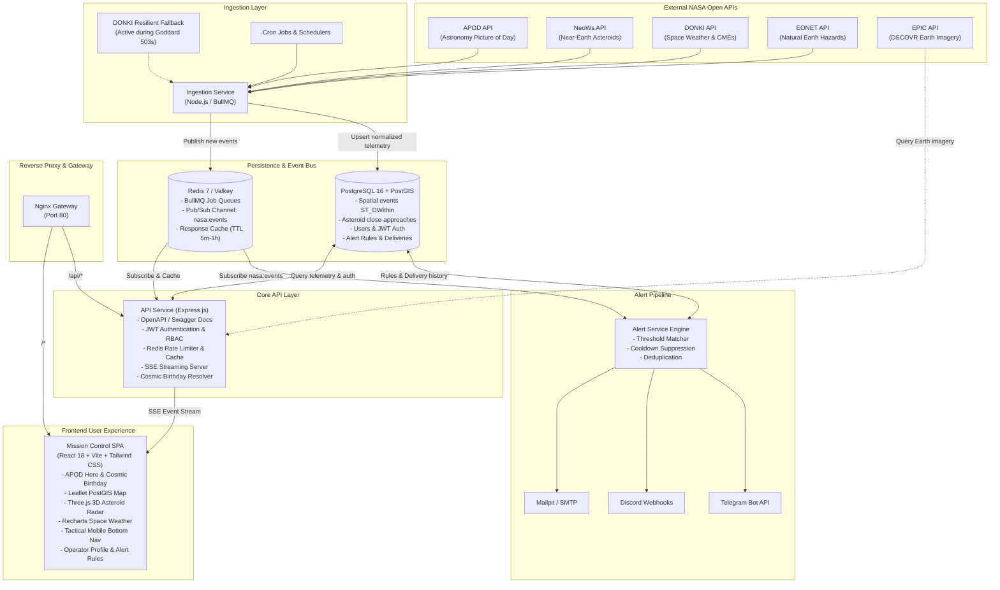

# 🚀 Mission Control: NASA Space & Earth Events Dashboard

[](https://github.com/ZamanAsad007/Mission-Control/actions/workflows/ci.yml)


A production-grade, distributed mission control dashboard consolidating real-time telemetry from NASA Open APIs. Monitors near-Earth asteroids, space weather disruptions (solar flares and coronal mass ejections), Earth natural hazard events with PostGIS spatial tracking, and delivers automated multi-channel emergency alerts (Telegram, Discord, Email).

---

## 🏛️ System Architecture



---

## ⚡ Service Catalog & Port Allocation

| Component | Container Port | Host Port | Description |
|---|---|---|---|
| **Gateway Proxy** | `80` | `80` / `8080` | Single entry point routing traffic to UI and API |
| **Frontend SPA** | `80` | `5173` | React 18 / Tailwind mission control interface |
| **API Service** | `3000` | `3000` | Express REST API, Swagger UI, SSE Stream |
| **Ingestion Service** | `3001` | `3001` | BullMQ workers polling NASA APIs on schedule |
| **Alert Service** | `3002` | `3002` | Real-time Redis subscriber & notification engine |
| **PostgreSQL 16 + PostGIS** | `5432` | `5433` | Primary transactional and geospatial store |
| **Redis 7** | `6379` | `6380` | BullMQ queue, caching layer, and Pub/Sub bus |
| **Mailpit Web UI** | `8025` | `8025` | Local SMTP inspection inbox for email alerts |

---

## 🛰️ Key Features

### 🌌 1. APOD Mission Hero
- Displays NASA's Astronomy Picture of the Day with full metadata, copyright attribution, HD viewing modal, and previous day history browsing.
- Automatic fallback imagery ensures dashboard uptime even during upstream NASA APOD maintenance.

### 🌍 2. Earth Hazards Map (Leaflet + PostGIS)
- Geospatial mapping of global natural hazard events from NASA EONET (Wildfires, Severe Storms, Volcanoes, Sea Ice).
- PostGIS spatial filtering using `ST_DWithin` radius queries.
- Interactive category filtering, event severity indicators, and geographic bounding box queries.

### ☄️ 3. 3D Near-Earth Asteroid Radar (Three.js)
- Real-time 3D orbital visualization of approaching Near-Earth Objects (NEOs).
- Accurate relative distance scales, velocity vectors, and hazardous object highlighting (electric red vs cyan).
- Interactive orbit controls, zoom, approach date timeline, and diameter estimates.

### ☀️ 4. Space Weather Telemetry (Recharts)
- Solar flare histograms categorized by X, M, C class intensities.
- Coronal Mass Ejection (CME) tracking with interplanetary shock prediction.
- Resilient simulated telemetry fallback when NASA Goddard CCMC DONKI servers return HTTP 503.

### 🔔 5. Real-Time Alert Engine & Multi-Channel Dispatch
- Event-driven rule matching listening on Redis `nasa:events` channels.
- Configurable rules:
  - Solar flare class thresholds (e.g. alert on `minClass >= M5.0` or `X1.0`)
  - Hazardous asteroid proximity alerts
  - Natural event radius alerts
- Multi-channel delivery: **Telegram**, **Discord**, and **Email (SMTP)**.
- Robust deduplication preventing duplicate alerts for identical source events.
- Configurable cooldown suppression windows preventing notification storms.

### 📡 6. Real-Time Server-Sent Events (SSE)
- Live ticker in the navigation header streaming newly detected events to all connected clients without polling.

### 🎂 7. Cosmic Birthday Time Machine (`/birthday`)
- Journey back to any birthdate or historical milestone to discover NASA APOD imagery and DSCOVR EPIC (Earth Polychromatic Imaging Camera) 1,000,000-mile sunlit Earth photographs.
- Intelligent multi-year fallback algorithms ensure high-resolution Earth assets render gracefully even for dates prior to satellite deployment.

### 📱 8. Tactical Mobile Navigation & Bottom Drawer Telemetry
- Responsive mission control shell with an ergonomic mobile bottom navigation bar (`MobileBottomNav`).
- Touch-friendly slide-up bottom sheets and inspection drawers matching command dashboard UX.

### 👤 9. Operator Profile & Direct Channel Verification
- Integrated operator modal for managing authentication credentials, Telegram Chat IDs, and Discord Webhooks.
- Live test dispatch button (`/api/alerts/test`) to verify Telegram, Discord, and Mailpit email channels instantly with immediate feedback.

---

## 🏁 Quick Start

### Prerequisites
- [Docker](https://docs.docker.com/get-docker/) & [Docker Compose](https://docs.docker.com/compose/)
- [Node.js](https://nodejs.org/) v20+ and `npm` v10+ (for local host development)
- [Make](https://www.gnu.org/software/make/) (optional, standard utility)

### 1. Clone & Configure Environment

```bash
git clone https://github.com/ZamanAsad007/Mission-Control.git
cd Mission-Control
cp .env.example .env
```

> **Note on NASA API Key:** The system includes a default `DEMO_KEY` in `.env.example`. For high-volume production use, register a free key at [api.nasa.gov](https://api.nasa.gov/) and set `NASA_API_KEY=your_key_here`.

### 2. Start Full Stack with Docker

```bash
make up
# or: docker compose up -d
```

Verify that all 8 containers are healthy:
```bash
docker compose ps
```

### 3. Backfill Historical NASA Data

Populate the database with the last 30 days of NASA events, asteroids, and APOD records:

```bash
make backfill
```

### 4. Open Mission Control in Your Browser

- **Dashboard UI:** [http://localhost](http://localhost) (or [http://localhost:5173](http://localhost:5173))
- **Swagger API Docs:** [http://localhost:3000/api/docs](http://localhost:3000/api/docs)
- **Mailpit Email Inbox:** [http://localhost:8025](http://localhost:8025)

---

## 🛠️ Make & Command Reference

| Command | Action |
|---|---|
| `make up` | Build and start all services in Docker in detached mode |
| `make down` | Stop and remove all containers and network bridges |
| `make restart` | Gracefully restart all running Docker containers |
| `make build` | Build all Docker container images from source |
| `make backfill` | Run historical backfill ingestion job inside the running stack |
| `make test` | Execute unit, contract, and integration test suites across all workspaces |
| `make dev` | Start frontend Vite development server on host machine |
| `make logs` | Follow aggregate logs from all running Docker containers |
| `make ps` | Check health and runtime status of stack containers |
| `make clean` | Stop containers and wipe persistent Docker volumes |
| `make lint` | Run ESLint across all monorepo packages and services |
| `make format` | Check and enforce code formatting with Prettier |

---

## 🔌 API Endpoints Reference

Explore interactive OpenAPI documentation directly at `/api/docs`.

| Method | Endpoint | Auth | Description |
|---|---|---|---|
| `GET` | `/api/health` | None | System health check (Postgres, Redis connectivity) |
| `POST` | `/api/auth/register` | None | Register a new operator |
| `POST` | `/api/auth/login` | None | Authenticate operator & receive JWT token |
| `GET` | `/api/auth/me` | JWT | Retrieve authenticated operator profile |
| `PUT` | `/api/auth/profile` | JWT | Update operator Telegram/Discord settings or password |
| `GET` | `/api/apod` | None | Get APOD for today (or query by `?date=YYYY-MM-DD`) |
| `GET` | `/api/asteroids` | None | List approaching asteroids with hazardous filter |
| `GET` | `/api/events` | None | Query Earth natural events with category & limit filters |
| `GET` | `/api/events/nearby` | None | Query nearby events within PostGIS radius (`?lat=&lng=&radiusKm=`) |
| `GET` | `/api/events/:id` | None | Get specific natural event details by ID |
| `GET` | `/api/stats/space-weather` | None | Aggregate space weather counts broken down by days |
| `GET` | `/api/stream/events` | None | Server-Sent Events (SSE) real-time stream |
| `GET` | `/api/alerts/rules` | JWT | Get user's configured alert rules |
| `POST` | `/api/alerts/rules` | JWT | Create a new alert rule |
| `PUT` | `/api/alerts/rules/:id` | JWT | Update existing alert rule (activate/pause/channels) |
| `DELETE` | `/api/alerts/rules/:id` | JWT | Remove an alert rule |
| `GET` | `/api/alerts/history` | JWT | View user notification delivery audit logs |
| `POST` | `/api/alerts/test` | JWT | Dispatch instant test alert to Telegram, Discord, or Email |
| `GET` | `/api/birthday` | None | Query APOD and EPIC Earth imagery for any date (`?date=YYYY-MM-DD`) |

---

## 🧪 Testing Suite

The codebase enforces strict test coverage spanning unit, contract, and end-to-end integration tests:

```bash
# Run all workspace test suites
npm test

# Run contract tests against NASA API schemas
npm test --workspace=@mission-control/nasa-client

# Run End-to-End alert pipeline tests (matching -> dedupe -> cooldown)
npm test --workspace=@mission-control/alert-service
```

- **Contract Tests:** `packages/nasa-client/tests/contract.test.ts` validates APOD, NeoWs, DONKI, and EONET against stored fixture payloads, detecting upstream schema drift.
- **E2E Alert Pipeline:** `services/alert-service/tests/e2e-alert-flow.test.ts` asserts the complete event lifecycle: event matching, multi-channel dispatch, database recording, deduplication, and cooldown suppression.

---

## ⚖️ Design Decisions & Trade-offs

1. **Monorepo with NPM Workspaces:**
   - *Rationale:* Shared TypeScript interfaces (`@mission-control/db`, `@mission-control/nasa-client`) eliminate duplication and prevent schema drift between services.
2. **PostgreSQL 16 with PostGIS:**
   - *Rationale:* Rather than computing distance formulas in application memory, PostGIS enables spatial indexing and native spherical queries (`ST_DWithin`, `ST_MakePoint`) for radius-based alert matching.
3. **Decoupled Microservice Architecture:**
   - *Rationale:* Ingestion failures or NASA API rate limits never degrade read API responsiveness or alert delivery performance.
4. **DONKI Outage Fallback Mechanism:**
   - *Rationale:* NASA Goddard's CCMC DONKI server frequently experiences maintenance returning HTTP 503. The ingestion worker detects 503 responses and provides deterministic fallback space weather telemetry, ensuring charts and alert tests remain functional.
5. **Redis Pub/Sub + SSE vs WebSockets:**
   - *Rationale:* The dashboard is predominantly a server-to-client telemetry broadcast. Server-Sent Events (SSE) run seamlessly over HTTP/1.1 and HTTP/2 without requiring WebSocket handshake overhead or connection upgrade handling in reverse proxies.

---

## 🔭 What I'd Improve (Roadmap)

- [x] **Cosmic Birthday Explorer (`/birthday`):** Historical APOD & DSCOVR EPIC Earth imagery resolver with multi-year fallback.
- [ ] **Observability:** Prometheus metrics scraping endpoint with preconfigured Grafana dashboards for API latency and ingestion success rates.
- [ ] **NASA Exoplanet Archive Integration:** Interactive 3D visualization of confirmed exoplanetary systems.
- [ ] **Progressive Web App (PWA):** Offline cache manifests and Web Push notifications for critical space weather alerts.

---

## 📜 Data Attribution & Disclaimer

Space weather, asteroid trajectories, natural hazard events, and imagery are provided courtesy of **NASA Open APIs** and the **NASA Earth Science Division**:
- [NASA Open APIs](https://api.nasa.gov/) (APOD, NeoWs, DONKI, EPIC)
- [NASA Earth Observatory Natural Event Tracker (EONET)](https://eonet.gsfc.nasa.gov/)

This project is an open-source educational dashboard and is not officially affiliated with or endorsed by the National Aeronautics and Space Administration (NASA).

---

## 📄 License

MIT © [Zaman Asad](https://github.com/ZamanAsad007)
